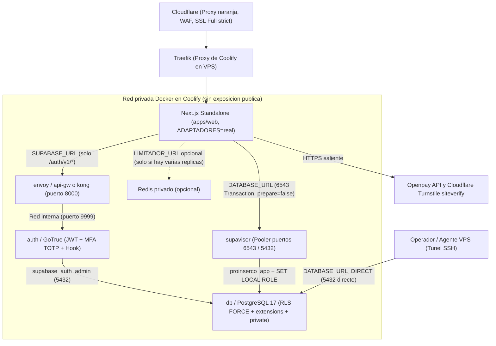

# Servicios Supabase para VPS

Guía operativa para desplegar **Supabase Self-Hosted** en el VPS de DigitalOcean gestionado con **Coolify**, optimizando RAM y CPU. Complementa [[ADR-0003 - Despliegue en VPS DigitalOcean con Coolify tras Cloudflare]], [[Handoff para Backend]] y [[Checklist de Seguridad para Producción]].

> [!important] **Principio rector de Proinserco**
> En esta aplicación **el navegador nunca habla con Supabase** (`.env.example` y `apps/web/src/server/env.ts` no definen variables `NEXT_PUBLIC_SUPABASE_*`). Toda consulta SQL corre del lado del servidor con Drizzle contra PostgreSQL (`DATABASE_URL`) y toda llamada a Auth corre del lado del servidor vía `@supabase/ssr` (`SUPABASE_URL`, `SUPABASE_ANON_KEY`). Por ello, el VPS solo ejecuta el núcleo mínimo de 4 contenedores en la red privada de Docker.

---

## 1. Matriz de servicios de Supabase Self-Hosted (arquitectura Docker 2026)

### 1.1 Obligatorios (4 servicios núcleo)

| Servicio | Imagen / Tecnología | Puerto interno | Por qué es obligatorio |
|---|---|---|---|
| `db` | `supabase/postgres` (**PostgreSQL 17**) | `5432` | Alineado con `major_version = 17` en `supabase/config.toml`. Aloja las tablas de dominio, `public.usuario_roles`, `public.perfiles`, el esquema `auth.*`, los esquemas `extensions` (`pg_trgm`, `pgcrypto`) y `private`, RLS forzado y `public.custom_access_token_hook(jsonb)`. |
| `supavisor` | `supabase/supavisor` | `6543` / `5432` | Pooler nativo de conexiones. Expone **Transaction Mode** en el puerto `6543` para `DATABASE_URL` de `apps/web` (exige `prepare: false` en el cliente Postgres/Drizzle) usando el rol `proinserco_app` y `SET LOCAL ROLE` por transacción sin agotar conexiones del VPS. También expone Session Mode en `5432`. |
| `auth` | `supabase/gotrue` (GoTrue) | `9999` | Gestiona el acceso al panel (`/acceso`), MFA TOTP obligatorio (`aal2`), rotación de refresh tokens, caducidad de sesiones (`timebox` e inactividad) y la invocación de `public.custom_access_token_hook` para inyectar `app_metadata.rol` en el JWT. |
| `envoy` (o `kong`) | `api-gw` (`envoy`, defecto 2026) / `kong` (`docker-compose.kong.yml`) | `8000` | API Gateway HTTP interno en la red privada Docker de Coolify (en la arquitectura Docker 2026 **Envoy** reemplaza a Kong manteniendo compatibilidad). Solo enruta `/auth/v1/*` hacia `auth` validando `apikey`/`Authorization` (`SUPABASE_ANON_KEY`, `SUPABASE_SERVICE_ROLE_KEY`). **No se expone a Internet**; Next.js fija `SUPABASE_URL` hacia su URL interna (ej. `http://api-gw:8000` o `http://envoy:8000`). |

### 1.2 Opcionales (administración puntual y correo)

| Servicio | Estado recomendado en producción | Cuándo activarlo |
|---|---|---|
| `studio` + `meta` (`postgres-meta`) | **Apagados en producción normal** | Levantar solo bajo demanda para inspección puntual y enlazar únicamente a `127.0.0.1` vía túnel SSH. Nunca publicarlos tras Traefik ni Cloudflare. |
| Relay **SMTP** externo | Opcional según flujo de alta | Requerido por `auth` únicamente si se usa alta por invitación (`--modo invitacion` en `scripts/alta-usuario-panel.mjs`) o recuperación por correo. Sin SMTP, el alta inicial del panel usa `--modo contrasena`. |

### 1.3 Descartados / NO desplegar en el VPS

Omitir estos contenedores ahorra cientos de MB de RAM, evita ciclos de CPU ociosos y reduce la superficie de ataque:

| Servicio descartado | Motivo técnico verificado en el repositorio |
|---|---|
| `rest` (**PostgREST**) | **NO desplegar.** La app consulta Postgres directamente con Drizzle a través de `supavisor` (`6543`). Además, `20261118003625_extensiones_y_roles.sql` y `20261118003647_rls_privilegios_e_inmutabilidad.sql` revocan todos los permisos de `PUBLIC`, `anon` y `authenticated` sobre `public`, `private` y `graphql_public` (Data API y GraphQL cerradas). Para altas administrativas, `scripts/alta-usuario-panel.mjs` soporta `--metodo-bd sql` (o fallback automático en `auto`) sincronizando IAM vía `psql` contra `DATABASE_URL_DIRECT`. |
| `realtime` | **NO desplegar.** No hay suscripciones WebSocket ni canales en tiempo real; todas las lecturas del panel son server-side. |
| `storage` e `imgproxy` | **NO desplegar.** El sistema no almacena ni transforma archivos en buckets de Supabase. |
| `edge-runtime` | **NO desplegar.** La lógica de negocio, verificación Turnstile y el webhook `/api/webhooks/openpay` corren en Next.js (`apps/web`, `output: 'standalone'`). |
| `analytics` (Logflare) y `vector` | **NO desplegar.** Alto consumo de RAM/CPU innecesario; los logs JSON de `apps/web/src/server/registro.ts` salen por `stdout` hacia Coolify/Docker. |

> [!note] **Nota sobre Redis (`LIMITADOR_URL`)**
> `apps/web/src/shared/infrastructure/limitador-redis.ts` (`crearLimitadorRedis`) ya está implementado (sobre `ioredis` con script Lua atómico de ventana fija y fallo cerrado por defecto) y cableado en `apps/web/src/server/container.ts`. Con una sola instancia de `apps/web`, dejar `LIMITADOR_URL` vacío utiliza el limitador en memoria (`crearLimitadorMemoria`); si se escalan múltiples réplicas, basta definir `LIMITADOR_URL` (`redis://…` en red privada o `rediss://…` TLS) para compartir el límite de tasa entre instancias.

---

## 2. Topología optimizada en la red privada Docker (Coolify)



---

## 3. Variables obligatorias para GoTrue (`auth`)

Estas variables para el contenedor `auth` (`docker-compose.yml` / recurso en Coolify) replican exactamente las políticas de `supabase/config.toml`, `supabase/migrations/20261118003641_iam_y_custom_access_token_hook.sql` y la sección 8 de [[Handoff para Backend]].

### 3.1 Conexión, JWT y Hook IAM

| Variable | Valor requerido | Fuente / Propósito |
|---|---|---|
| `GOTRUE_DB_DRIVER` | `postgres` | Motor de base de datos de GoTrue |
| `GOTRUE_DB_DATABASE_URL` | `postgres://supabase_auth_admin:<POSTGRES_PASSWORD>@db:5432/postgres` | Conexión interna directa al servicio `db` |
| `GOTRUE_JWT_SECRET` | `<secreto-jwt-compartido>` | Secreto HS256 compartido con `envoy`/`kong` para firmar/validar `SUPABASE_ANON_KEY` y `SUPABASE_SERVICE_ROLE_KEY` |
| `GOTRUE_JWT_EXP` | `3600` | `jwt_expiry = 3600` (1 hora) |
| `API_EXTERNAL_URL` | `http://api-gw:8000` (o URL interna del gateway) | Base interna de Auth dentro de la red privada |
| `GOTRUE_HOOK_CUSTOM_ACCESS_TOKEN_ENABLED` | `true` | `[auth.hook.custom_access_token] enabled = true` |
| `GOTRUE_HOOK_CUSTOM_ACCESS_TOKEN_URI` | `pg-functions://postgres/public/custom_access_token_hook` | Invoca `public.custom_access_token_hook(jsonb)` usando `supabase_auth_admin` sobre `public.usuario_roles` |

### 3.2 Registro, URLs exactas y seguridad de contraseñas

| Variable | Valor requerido | Fuente / Propósito |
|---|---|---|
| `GOTRUE_DISABLE_SIGNUP` | `true` | `enable_signup = false`: prohíbe registro público; solo entran cuentas creadas por administración |
| `GOTRUE_EXTERNAL_EMAIL_ENABLED` | `true` | Acceso de cuentas del panel por correo y contraseña |
| `GOTRUE_EXTERNAL_PHONE_ENABLED` | `false` | `[auth.sms] enable_signup = false` |
| `GOTRUE_EXTERNAL_ANONYMOUS_USERS_ENABLED` | `false` | `enable_anonymous_sign_ins = false` |
| `GOTRUE_SECURITY_MANUAL_LINKING_ENABLED` | `false` | `enable_manual_linking = false` |
| `GOTRUE_PASSWORD_MIN_LENGTH` | `12` | `minimum_password_length = 12` |
| `GOTRUE_PASSWORD_HIBP_ENABLED` | `true` | Bloquea contraseñas filtradas (HIBP, requerido en `Handoff para Backend` sección 8) |
| `GOTRUE_SITE_URL` | `https://<dominio-real>` | Igual a `APP_URL`, sin barra final |
| `GOTRUE_URI_ALLOW_LIST` | `https://<dominio-real>/acceso,https://<dominio-real>/panel` | **URLs exactas separadas por comas, sin comodines `*`** (`additional_redirect_urls`) |

### 3.3 Correo, rotación de tokens, sesiones y MFA TOTP

| Variable | Valor requerido | Fuente / Propósito |
|---|---|---|
| `GOTRUE_MAILER_AUTOCONFIRM` | `false` | `enable_confirmations = true`: nunca auto-confirmar registros no verificados |
| `GOTRUE_MAILER_SECURE_EMAIL_CHANGE_ENABLED` | `true` | `double_confirm_changes = true` |
| `GOTRUE_SECURITY_UPDATE_PASSWORD_REQUIRE_REAUTHENTICATION` | `true` | `secure_password_change = true` |
| `GOTRUE_MAILER_OTP_EXP` | `3600` | `otp_expiry = 3600` (1 hora) |
| `GOTRUE_RATE_LIMIT_EMAIL_SENT` | `2` | `email_sent = 2` por hora cuando haya SMTP configurado (`GOTRUE_SMTP_*`) |
| `GOTRUE_SECURITY_REFRESH_TOKEN_ROTATION_ENABLED` | `true` | `enable_refresh_token_rotation = true` (detección de reuso/robo) |
| `GOTRUE_SECURITY_REFRESH_TOKEN_REUSE_INTERVAL` | `10` | `refresh_token_reuse_interval = 10` segundos |
| `GOTRUE_SESSIONS_TIMEBOX` | `8h` | `timebox = "8h"` (caducidad absoluta de sesión) |
| `GOTRUE_SESSIONS_INACTIVITY_TIMEOUT` | `30m` | `inactivity_timeout = "30m"` (cierre por inactividad) |
| `GOTRUE_MFA_MAX_ENROLLED_FACTORS` | `10` | `max_enrolled_factors = 10` |
| `GOTRUE_MFA_TOTP_ENROLL_ENABLED` | `true` | `[auth.mfa.totp] enroll_enabled = true` |
| `GOTRUE_MFA_TOTP_VERIFY_ENABLED` | `true` | `[auth.mfa.totp] verify_enabled = true` (exigido para escalar a `aal2`) |
| `GOTRUE_MFA_PHONE_ENROLL_ENABLED` | `false` | `[auth.mfa.phone] enroll_enabled = false` |
| `GOTRUE_MFA_PHONE_VERIFY_ENABLED` | `false` | `[auth.mfa.phone] verify_enabled = false` |

---

## 4. Guía paso a paso post-despliegue (agente / ingeniero de VPS)

### Paso 1 — Aplicar las 5 migraciones reales vía `DATABASE_URL_DIRECT` (sin `supabase/seed.sql`)

Las migraciones deben aplicarse en orden estricto sobre la conexión directa a `db` (puerto `5432`), nunca sobre Supavisor en puerto `6543`:

1. `supabase/migrations/20261118003625_extensiones_y_roles.sql`
2. `supabase/migrations/20261118003635_tablas_dominio.sql`
3. `supabase/migrations/20261118003641_iam_y_custom_access_token_hook.sql`
4. `supabase/migrations/20261118003647_rls_privilegios_e_inmutabilidad.sql`
5. `supabase/migrations/20261118010625_permitir_expirar_donacion_creada.sql`

Abre un túnel SSH hacia el contenedor `db` (o ejecuta desde el propio VPS contra la red Docker) y aplica las migraciones:

```bash
# Ejemplo desde estación de operador abriendo túnel SSH hacia db:5432 en el VPS:
ssh -N -L 15432:127.0.0.1:5432 <usuario>@<ip-vps>

# En otra terminal, exportar la conexión directa y aplicar migraciones:
export DATABASE_URL_DIRECT="postgresql://postgres:<POSTGRES_PASSWORD>@127.0.0.1:15432/postgres"

# Opción A: con Supabase CLI
supabase db push --db-url "$DATABASE_URL_DIRECT"

# Opción B: con psql directo en orden exacto (si no hay Supabase CLI en el host)
for f in \
  supabase/migrations/20261118003625_extensiones_y_roles.sql \
  supabase/migrations/20261118003635_tablas_dominio.sql \
  supabase/migrations/20261118003641_iam_y_custom_access_token_hook.sql \
  supabase/migrations/20261118003647_rls_privilegios_e_inmutabilidad.sql \
  supabase/migrations/20261118010625_permitir_expirar_donacion_creada.sql
do
  psql "$DATABASE_URL_DIRECT" -v ON_ERROR_STOP=1 -f "$f"
done
```

> [!danger] **No ejecutar `supabase db reset` ni `supabase/seed.sql` en staging/producción**
> Aunque `supabase/seed.sql` está limpio de datos demo y secretos, en entornos desplegados únicamente se aplican migraciones hacia adelante sobre `DATABASE_URL_DIRECT`.

---

### Paso 2 — Fijar contraseña de `proinserco_app` y construir `DATABASE_URL` vs `DATABASE_URL_DIRECT`

La migración 1 crea `proinserco_app` (`LOGIN NOSUPERUSER NOCREATEDB NOCREATEROLE NOBYPASSRLS NOINHERIT`) sin contraseña. Asigna una contraseña aleatoria criptográfica **forzando `scram-sha-256`** (requerido por Supavisor; hashes `md5` fallan con `28P01`):

```bash
CLAVE_APP="$(openssl rand -base64 36 | tr -d '\n')"

psql "$DATABASE_URL_DIRECT" -v ON_ERROR_STOP=1 -v clave="$CLAVE_APP" <<'SQL'
SET password_encryption = 'scram-sha-256';
ALTER ROLE proinserco_app WITH PASSWORD :'clave';
SQL
```

Diferencia exacta entre las dos variables definidas en `.env.example`:

| Variable | Destino y puerto | Rol PostgreSQL | Dónde vive | Notas críticas |
|---|---|---|---|---|
| `DATABASE_URL` | `supavisor:6543` (**Transaction Mode**) | `proinserco_app.<POOLER_TENANT_ID>` | Variables runtime de `apps/web` en Coolify | En el stack `supabase/docker`, Supavisor identifica el tenant en el usuario (`proinserco_app.<POOLER_TENANT_ID>`, según `POOLER_TENANT_ID` en el `.env` de Supabase). El cliente Postgres/Drizzle debe usar `prepare: false` y ejecutar `SET LOCAL ROLE proinserco_publico \| proinserco_sistema \| proinserco_panel` en cada transacción. Codificar caracteres especiales (`@`, `#`, `:`, `/`) en URL. |
| `DATABASE_URL_DIRECT` | `db:5432` (**Conexión directa**, o vía túnel SSH) | `postgres` | **Solo sesión temporal** de migraciones y `scripts/alta-usuario-panel.mjs` | **Nunca** se configura en el runtime de producción de `apps/web`. |

Ejemplo de `DATABASE_URL` para Coolify (red interna Docker):

```env
DATABASE_URL="postgresql://proinserco_app.<POOLER_TENANT_ID>:<CLAVE_APP_URL_ENCODED>@supavisor:6543/postgres"
```

---

### Paso 3 — Crear el primer usuario administrador con `scripts/alta-usuario-panel.mjs`

El alta administrativa crea el usuario en GoTrue (`auth.users`) y sincroniza su fila en `public.usuario_roles` (fuente de verdad del hook JWT) y `public.perfiles`.

Con túnel SSH abierto hacia `envoy`/`api-gw` (`18000 -> api-gw:8000`) y `db` (`15432 -> db:5432`), o ejecutando dentro de la red privada del VPS:

```bash
export SUPABASE_URL="http://127.0.0.1:18000"
export SUPABASE_SERVICE_ROLE_KEY="<SERVICE_ROLE_KEY>"
export DATABASE_URL_DIRECT="postgresql://postgres:<POSTGRES_PASSWORD>@127.0.0.1:15432/postgres"

# 1. Sin SMTP configurado (primer arranque): pide contraseña oculta (>= 12 caracteres)
node scripts/alta-usuario-panel.mjs \
  --correo admin@proinserco.org \
  --nombre "Nombre Admin" \
  --rol administrador \
  --modo contrasena \
  --metodo-bd sql

# 2. Con SMTP configurado (envía invitación por correo):
node scripts/alta-usuario-panel.mjs \
  --correo persona@proinserco.org \
  --nombre "Nombre Consulta" \
  --rol consulta \
  --modo invitacion \
  --metodo-bd sql
```

**Fallback si no tienes `psql` local ni PostgREST (`rest` apagado):**

Al omitir el contenedor `rest`, el modo `--metodo-bd auto` detectará HTTP `404`/`502`/`503` en `/rest/v1`. Si además falta el binario `psql` en tu máquina local, el script deja creado el usuario en Auth e imprime en `stderr` el bloque SQL exacto con el `userId` validado para aplicarlo directamente en el contenedor `db` del VPS:

```bash
docker exec -i <contenedor-postgres> psql -U postgres -d postgres -v ON_ERROR_STOP=1 <<'SQL'
BEGIN;
INSERT INTO public.usuario_roles (user_id, rol)
VALUES ('<UUID_DEVUELTO_POR_AUTH>'::uuid, 'administrador')
ON CONFLICT (user_id) DO UPDATE
  SET rol = EXCLUDED.rol,
      actualizado_en = now();

INSERT INTO public.perfiles (user_id, nombre)
VALUES ('<UUID_DEVUELTO_POR_AUTH>'::uuid, 'Nombre Admin')
ON CONFLICT (user_id) DO UPDATE
  SET nombre = EXCLUDED.nombre,
      actualizado_en = now();
COMMIT;
SQL
```

> [!note] **Primer inicio de sesión**
> Al ingresar a `/acceso` con la contraseña inicial, el panel exige obligatoriamente enrolar y verificar un factor MFA TOTP para alcanzar el nivel `aal2`.

---

### Paso 4 — Verificaciones cortas post-despliegue

Ejecuta estas cuatro comprobaciones rápidas antes de habilitar `ADAPTADORES=real` en `apps/web`:

```bash
# 1. Roles de aplicación sin BYPASSRLS, sin SUPERUSER y con NOINHERIT
psql "$DATABASE_URL_DIRECT" -c "
SELECT rolname, rolcanlogin, rolinherit, rolsuper, rolbypassrls
FROM pg_roles
WHERE rolname LIKE 'proinserco_%'
ORDER BY rolname;"

# 2. Todas las tablas de public (9 tablas) con RLS ENABLE + FORCE activos
psql "$DATABASE_URL_DIRECT" -c "
SELECT c.relname AS tabla, c.relrowsecurity AS rls_habilitado, c.relforcerowsecurity AS rls_forzado
FROM pg_class c
JOIN pg_namespace n ON n.oid = c.relnamespace
WHERE n.nspname = 'public' AND c.relkind = 'r'
ORDER BY c.relname;"

# 3. Extensiones pg_trgm y pgcrypto en el esquema extensions
psql "$DATABASE_URL_DIRECT" -c "
SELECT e.extname, n.nspname AS esquema
FROM pg_extension e
JOIN pg_namespace n ON n.oid = e.extnamespace
WHERE e.extname IN ('pg_trgm', 'pgcrypto')
ORDER BY e.extname;"

# 4. Prueba del Custom Access Token Hook (debe proyectar claims.app_metadata.rol)
psql "$DATABASE_URL_DIRECT" -c "
SELECT public.custom_access_token_hook(
  jsonb_build_object(
    'user_id', (SELECT user_id::text FROM public.usuario_roles LIMIT 1),
    'claims', jsonb_build_object('app_metadata', '{}'::jsonb)
  )
)->'claims'->'app_metadata' AS app_metadata_resultante;"
```

Comprobación adicional del gateway interno y pooler:

```bash
# Gateway Envoy/Kong respondiendo salud de GoTrue (/auth/v1/health -> HTTP 200)
curl -sf -H "apikey: $SUPABASE_ANON_KEY" "$SUPABASE_URL/auth/v1/health"

# Conexión por Supavisor Transaction Mode (6543; ej. tras túnel SSH `ssh -N -L 16543:supavisor:6543 ...` o directo a `supavisor:6543` en la red Docker)
psql "postgresql://proinserco_app.<POOLER_TENANT_ID>:<CLAVE_APP_URL_ENCODED>@127.0.0.1:16543/postgres" -c "
BEGIN;
SET LOCAL ROLE proinserco_publico;
SELECT current_user;
COMMIT;"
```

---

### Paso 5 — Scheduled Task diario en Coolify y relación entre `APP_URL` y `SUPABASE_URL`

1. **Scheduled Task diario de conciliación (`POST /api/cron/conciliacion`):**
   En Coolify, crea una tarea programada (**Scheduled Task**) diaria (por ejemplo `0 3 * * *`) contra el endpoint de conciliación:

   ```bash
   curl -fsS -X POST "https://proinserco.org/api/cron/conciliacion" \
     -H "Authorization: Bearer ${CRON_CONCILIACION_SECRETO}"
   ```

   `apps/web/src/app/api/cron/conciliacion/route.ts` exige `CRON_CONCILIACION_SECRETO` (mínimo 32 caracteres aleatorios en `apps/web/src/server/env.ts`, obligatorio con `ADAPTADORES=real`; si falta devuelve `404`), valida el token Bearer en tiempo constante y ejecuta `donaciones.conciliarPendientes()` bajo contexto de BD `{ modo: 'sistema' }` (concilia donaciones abiertas contra Openpay y expira intentos abandonados en estado `creada` sin cargo).

2. **Relación entre dominio público de la app (`APP_URL`) y el gateway de Supabase (`SUPABASE_URL`):**
   - `APP_URL=https://proinserco.org` (sin barra final) es el **dominio público de la aplicación** (`apps/web`): activa cookies `__Host-`/`Secure`, `upgrade-insecure-requests` en la CSP, el `hostname` esperado por Turnstile y la `redirect_url` de Openpay. En GoTrue debe coincidir con `GOTRUE_SITE_URL=https://proinserco.org` y `GOTRUE_URI_ALLOW_LIST=https://proinserco.org/acceso,https://proinserco.org/panel`.
   - `SUPABASE_URL` se usa **únicamente en servidor** (nunca en el navegador). La opción recomendada es la URL interna de la red privada Docker en Coolify (ej. `http://api-gw:8000` o `http://envoy:8000`). Si por separación de stacks se asigna un dominio público al gateway (ej. `https://sb.proinserco.org`), **mantenlo restringido** (firewall/red privada o acceso limitado) cuando no se consuma desde fuera, ya que PostgREST (Data API) está deshabilitado y `apps/web` solo necesita acceder a `/auth/v1/*` desde el servidor.

---

## Enlaces

- [[Handoff para Backend]] (`docs/05 - Backend/Handoff para Backend.md`, secciones 5, 8 y 11)
- [[Checklist de Seguridad para Producción]] (`docs/05 - Backend/Checklist de Seguridad para Producción.md`)
- [[ADR-0003 - Despliegue en VPS DigitalOcean con Coolify tras Cloudflare]] (`docs/03 - Decisiones/ADR-0003 - Despliegue en VPS DigitalOcean con Coolify tras Cloudflare.md`)
- [[ProInserco]] (`docs/ProInserco.md`)
